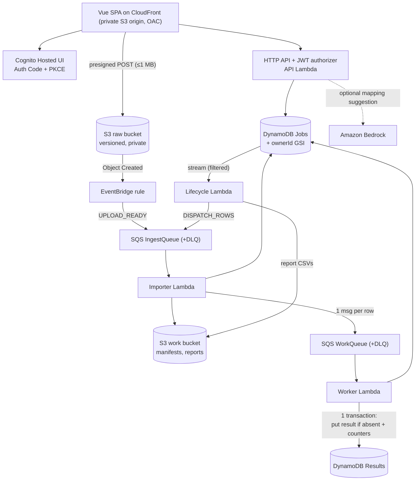

# Architecture

CatalogBridge turns supplier product CSVs (different column names, English or Chinese) into one
validated, versioned output schema (`catalogbridge.v1`) plus an error report. It is a small
asynchronous processing pipeline on AWS serverless services. This is the author's own design for
a demo MVP; it says nothing about how AWS builds its services internally.



Not drawn: CloudWatch logs/metrics/dashboard/alarms, SNS alert topic, EventBridge delivery DLQ,
stream failure destination, scheduled stall checker, presigned download links.

## Event consumers

| Source → consumer | Kind | Failure handling |
| --- | --- | --- |
| IngestQueue → Importer | Lambda SQS event source mapping, batch 5, max concurrency 2 | Partial batch response; IngestDLQ after 5 receives |
| WorkQueue → Worker | SQS event source mapping, batch 10, max concurrency 2 (configurable) | Partial batch response; WorkDLQ after 3 receives |
| Jobs table stream → Lifecycle | DynamoDB Streams event source mapping, batch 100, filter on status | Report first failed sequence number; bisect on error; 5 retries / 1 h max age; failure records to LifecycleFailureDLQ |
| S3 → EventBridge → IngestQueue | EventBridge rule target (not an event source mapping) | 8 retries / 2 h, then EventDeliveryDLQ |
| Browser → API Lambda | Synchronous HTTP | Client sees the error; idempotent create/run tokens make retries safe |
| Schedule → StallCheck | EventBridge schedule every 5 min | Emits `StalledJobs` metric (alarmed) |

Queues and streams behave differently: an SQS consumer reports individual failed message IDs and
SQS redelivers them after the visibility timeout; a stream consumer checkpoints by sequence number,
so a failure blocks that shard until the record succeeds, is bisected away, or expires to the
failure destination.

## Job lifecycle

```
CREATED -> VALIDATING_UPLOAD -> AWAITING_MAPPING -> RUN_REQUESTED -> PROCESSING -> REPORTING -> COMPLETED
                         \-> REJECTED (structural problem)                             \-> COMPLETED_WITH_ERRORS
```

- `COMPLETED_WITH_ERRORS` means some rows are INVALID business data (bad price, missing SKU). It
  never means system work was lost.
- A job with no progress for 10 minutes is shown as **stalled** in the UI and raises the
  `StalledJobs` alarm. Recovery keeps the same run identity (`scripts/recover.py`).
- Fixing data never changes a finished job: the user creates a new job with `parentJobId`.

## Data flow, step by step

1. **Create** (`POST /jobs`): `ownerId` comes from the verified JWT `sub`. `jobId` is
   `uuid5(ownerId, clientToken)`, so a double click returns the same job. Returns a presigned POST
   bound to `raw/{ownerId}/{jobId}/input.csv` with `content-length-range 1..1 MiB`, valid 5 min.
2. **Upload event**: S3 emits Object Created to EventBridge; the rule sends `UPLOAD_READY` with the
   object **versionId** to IngestQueue.
3. **Import**: conditional update binds that versionId to the job (`CREATED → VALIDATING_UPLOAD`).
   A different version for an already-bound job is ignored (new file = new job). The importer reads
   that exact version, validates structure, writes `manifests/{jobId}/{versionId}.json` (stable
   `rowNumber`s), and moves to `AWAITING_MAPPING` (or `REJECTED` with reasons).
4. **Mapping**: manual, from a saved per-user template, from the parent job, or suggested by Bedrock
   (headers + 3 truncated sample rows only). Every source goes through the same validation.
   Saves use optimistic concurrency on `mappingVersion`.
5. **Run** (`POST /jobs/{id}/run`): one conditional update freezes mapping, `runRequestId`,
   `expectedCount`, counters = 0, `dispatchComplete=false`, status `RUN_REQUESTED`. Nothing is
   sent to a queue by the API.
6. **Outbox via stream**: the Jobs stream delivers the `→ RUN_REQUESTED` change to Lifecycle, which
   sends `DISPATCH_ROWS` to IngestQueue. If the API crashed right after its write, the stream still
   carries the committed change; there is no "DB written but message lost" window in the API.
7. **Dispatch**: Importer moves the job to `PROCESSING`, sends one WorkQueue message per row with
   `SendMessageBatch`, checks every entry's result, and only then sets `dispatchComplete=true`. A
   crash midway makes SQS redeliver `DISPATCH_ROWS`; the full dispatch is repeated and the Worker
   deduplicates.
8. **Worker**: per row, one DynamoDB transaction: `Put Results[jobId,rowNumber]` with
   `attribute_not_exists` + `ADD processedCount, validCount|invalidCount` on the Job (conditioned on
   the same `runRequestId` and `PROCESSING`). On cancellation it proves a duplicate with a
   consistent read of the existing result's business key
   (`jobId#runRequestId#fileVersion#rowNumber`) before treating it as success. Transaction
   conflicts (many rows updating the same Job item) are retried with jitter.
9. **Finalize**: when a stream record shows `dispatchComplete && processedCount == expectedCount`,
   Lifecycle re-checks with a consistent read, conditionally enters `REPORTING`, queries all Results
   (paginated), writes deterministic report keys `reports/{jobId}/{runRequestId}/...`, and only
   then sets the terminal status. A retry that finds `REPORTING` continues.

## What the dedup guarantee covers

Within one run, each `(jobId, rowNumber)` result is written once and counted once, even with SQS
redelivery, re-dispatch with new message IDs, concurrent workers, or a crash after the commit.
It covers these DynamoDB writes only. It is not end-to-end exactly-once for arbitrary side effects
(emails, payments), and it relies on the Results item staying in the table (no TTL on Results).

## Security

- Cognito user pool with self sign-up disabled (invited accounts only); SPA public client without a
  secret, Authorization Code + PKCE; tokens kept in `sessionStorage`.
- API Gateway JWT authorizer validates issuer, audience, expiry; the Lambda checks ownership on every
  job/template and returns 404 for other users' IDs.
- All buckets private with Block Public Access and TLS-only policies; site served through CloudFront
  OAC; S3 CORS limited to the CloudFront origin and localhost dev.
- Presigned URLs are short-lived (5 min), key-bound and size-limited; the API never signs a
  client-supplied key.
- CSV output neutralizes formula injection (`'` prefix for text starting with `= + - @ TAB CR`).
- Bedrock receives only headers and 3 truncated sample rows, as JSON data, with no tools; output
  is schema-constrained and then re-validated; the user confirms before anything runs.
- Logs carry IDs (jobId, runRequestId, rowNumber, messageId), never JWTs or file contents.
- Backend limits: 1 MiB, 500 rows, 100 columns, 30 jobs/user/day, 3 AI attempts per job,
  API stage throttle 20 rps / burst 40.
